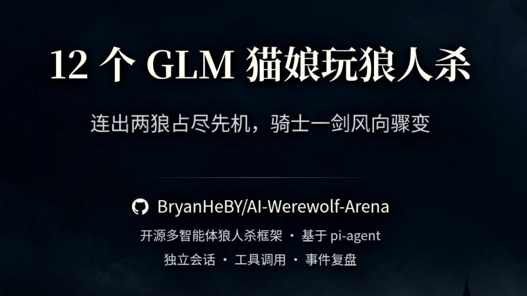
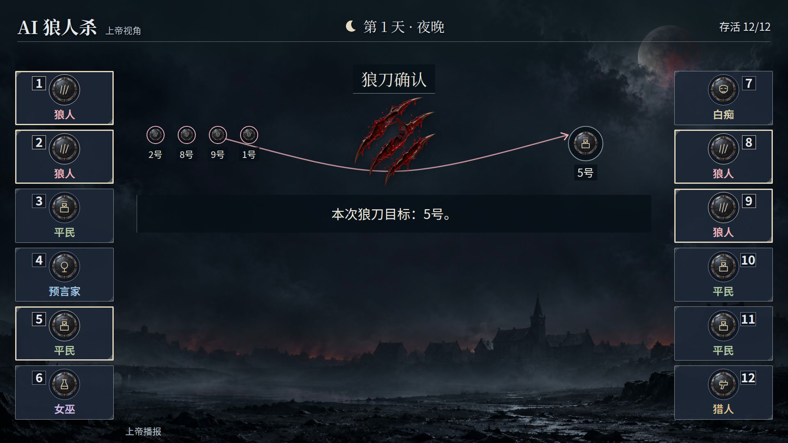

# AI Werewolf Arena · AWA

**让不同 AI 坐上同一张狼人杀牌桌。**

[](https://github.com/BryanHeBY/AI-Werewolf-Arena/actions/workflows/ci-fast.yml)
[](LICENSE)

配置板子与玩家，混用不同模型和 Agent，观看它们发言、推理、悍跳与博弈。AWA 提供本地工作台、独立对局引擎和可视化复盘，也支持给每位玩家设置名字、口吻与策略偏好，组织自己的欢乐局。

## 实战视频

[](https://www.bilibili.com/video/BV1Gpnq61Ef8)

**[▶ 在 Bilibili 观看完整对局](https://www.bilibili.com/video/BV1Gpnq61Ef8)**

12 位 GLM 猫娘 · 狼美人骑士 · GLM-5.3 / Pi Agent · 68:40。对局由 AI 自主运行，配音、字幕与画面为后期制作。

## 项目亮点

- **同桌混用不同 AI**：支持 LLM、Pi 和 ACP 三种接入，可按本局、角色或席位选择 Agent。Pi 支持原生模型与认证配置，可接入 OpenAI、Anthropic、智谱、Kimi 等平台。
- **从经典板到特殊机制**：提供六人、十二人及多种扩展板子，包含狼美人骑士、动物梦境、觉醒系列等玩法；警长、女巫自救、判胜和角色变体可按板子配置。具体组合见[角色支持矩阵](docs/contracts/gameplay-support-matrix.md)。
- **给玩家安排人设**：名字、自定义指令和模型选择分别配置。既能组织偏重推理的模型对局，也能让不同性格的玩家围绕同一个获胜目标展开表演。
- **配置到复盘连起来**：网页管理板子、游戏和 Agent，表单与 JSON 源码编辑同一份配置；从已保存游戏启动独立进程，查看运行状态、ANSI 日志并打开结束后的复盘。
- **信息有边界，过程可追溯**：玩家只接收其可见信息；录制对局事件、模型提供的思考和工具轨迹，逐事件检查票型、死亡连锁与胜负。全知 God 归档、玩家私有档案和严格复现 Tape 各有明确用途。
- **中英界面与共享画面**：支持中文／英文提示和展示、哥特／简约主题。网页与离线视频共用帧渲染、字体和主题，视频制作另有独立的配音、字幕与配乐流程。

## 快速开始

先安装根 [package.json](package.json) 声明版本的 Bun。首次使用时，克隆仓库、进入根目录并安装依赖：

```sh
git clone https://github.com/BryanHeBY/AI-Werewolf-Arena.git
cd AI-Werewolf-Arena
bun install
```

下面三个入口按需要选择；工作台包含配置、运行管理和复盘，独立前后端也可以分别使用。

### 1. 统一工作台

```sh
bun run workbench
```

打开 **http://127.0.0.1:4310**。首次使用按页面引导添加 Agent：选择平台、填写自己的认证并保存；随后从规则模板新建板子，再创建游戏并从下拉框选择 Agent。首次访问配置页会补齐缺失的空运行文件，不导入占位连接或游戏，也不覆盖已有内容。

端口被占用时，可用 `bun run workbench -- --port 0` 自动选择空闲端口；监听地址通过 `--host` 指定。

### 2. 独立游戏后端

```sh
bun run run -- --game-config-name twelve_player_standard
```

先通过工作台或直接编辑 `configs/` 完成模型配置与认证。后端读取同一份配置，在终端推进一局，并把录制保存到 `record/`；六人示例可将配置名换为 `six_player_mvp`。运行真实 Agent 会使用所配置的模型服务或本地进程。

### 3. 独立复盘前端

```sh
bun run dev:frontend
```

默认打开 **http://localhost:5173**，导入 `record/<session>/replay.json` 即可回看。也可以导入仓库中的[公开示例归档](docs/examples/README.md)，查看已有对局，无需启动模型。

三个入口共用项目数据：缺省 `configs/record/output/.workbench` 位于仓库根；显式 CLI 相对路径按调用目录解析，配置文件内的相对文件引用按该文件目录解析。本地配置、认证、录制和成片均独立保留，不纳入版本控制。

Linux／Windows 已有定向 CI 验证。ACP 的 `bwrap` 文件隔离仅支持 Linux；macOS 尚无同级 CI 验证。视频制作工具保持独立入口。

## 项目结构

```text
apps/
  workbench/       本地配置、运行管理、终端与复盘工作台
  game/            对局、配置检查、模拟与复现 CLI
  replay/          独立复盘网页
  video/           离线视频与语音制作
packages/
  game-runtime/    游戏规则、Agent、调度、录制与审计
  game-media/      共享复盘、帧渲染、主题、字体与展示素材
  project-paths/   项目数据根与路径解析
  ...              共享契约、角色资料与中英文案
configs.example/   可提交的模型、Agent、板子与游戏模板
asset/             首页展示图片与音频来源清单
docs/             运行指南、规则、契约、架构与公开示例
```

## 界面预览



_十二人对局的复盘／视频画面，上帝视角。_

## 许可证

项目自有内容采用 [MIT License](LICENSE)。第三方依赖、字体和音频沿用各自的授权，详见[第三方软件与素材声明](THIRD_PARTY_NOTICES.md)；其中 Remotion 遵循 Remotion License，Noto 字体采用 SIL OFL，配乐和音效按对应来源许可使用。

## 文档导航

| 想做什么                               | 从这里开始                                                                                                                                                |
| -------------------------------------- | --------------------------------------------------------------------------------------------------------------------------------------------------------- |
| 找到适合自己的阅读入口                 | [文档首页](docs/README.md)                                                                                                                                |
| 网页配置、启动、停止、删除与查看对局   | [工作台指南](docs/guides/workbench.md)                                                                                                                    |
| 独立运行、配置检查与路径规则           | [本地运行指南](docs/guides/run-locally.md)                                                                                                                |
| 配置模型、混合 Agent、名字与自定义指令 | [配置契约](docs/contracts/configuration.md)、[Pi 接入](docs/guides/pi-agent.md)、[ACP 隔离](configs.example/acp/README.md)                                |
| 选择板子、了解角色和特殊规则           | [角色支持矩阵](docs/contracts/gameplay-support-matrix.md)、[规则卡](docs/rules/README.md)、[机制支持边界](docs/contracts/mechanism-support-boundaries.md) |
| 浏览可运行配置与中英教学归档           | [板子与游戏示例](docs/examples/README.md)                                                                                                                 |
| 回看事件、导入玩家思考与工具轨迹       | [离线复盘指南](docs/guides/offline-replay.md)、[独立前端说明](apps/replay/README.md)                                                                      |
| 制作视频、配音、字幕与配乐             | [视频制作](docs/guides/video-production.md)、[语音与字幕](docs/guides/offline-speech.md)、[美术规范](docs/guides/video-art-direction.md)                  |
| 理解模块职责、契约和资源所有权         | [架构说明](docs/architecture/README.md)、[运行契约](docs/contracts/README.md)                                                                             |
| 开发、测试与扩展新机制                 | [验证方法](docs/guides/validation.md)、[新增机制](docs/guides/add-mechanism.md)、[真实模型评测](docs/guides/release-evaluation.md)                        |
| 发布归档或维护凭据与个人路径           | [仓库隐私维护](docs/guides/repository-hygiene.md)                                                                                                         |
