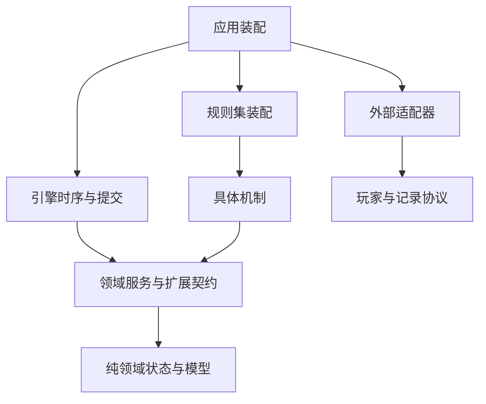

# AI Werewolf Arena 完整重构计划

本计划用于把持续扩充后的 AI Werewolf Arena 收敛为模块边界明确、状态所有权清晰、规则组合可解释、验证责任独立的模块化单体。实施目标是降低一次角色或规则变更需要理解和修改的范围，同时保留既有有限板子的实际规则、信息权限、资源生命周期、失败前缀和复现能力。

计划覆盖架构、状态与能力、请求授权、效果与死亡链、规则计划与 hook、玩家观察、记录与审计、package、目录与命名、测试与 fixture、i18n、文档与注释硬约束，以及实施阶段、验收和 commit 拆分。

| 项目           | 约定                                                         |
| -------------- | ------------------------------------------------------------ |
| 制定日期       | 2026 年 10 月 12 日，Asia/Shanghai                           |
| 项目路径       | `/home/hby/dev/AI-Werewolf-Arena`                            |
| 扩充前比较基线 | `88ed61c`，2026 年 10 月 1 日                                |
| 已提交证据快照 | `8a8d4bedc33c21e4b5beddfb06253b07b36fadd0`                   |
| 当前工作区     | 动物梦境接入正在开发；未提交内容单独登记，不作为已完成验收   |
| 文档状态       | 实施计划；阶段完成状态以执行时产生的证据为准                 |
| 当前交付范围   | 在指定目录保存计划及交叉审查结果；不修改项目源码、测试或配置 |
| 产品边界       | 继续保持 AI 对局、离线录制、复盘工作台与图片和视频输出链路   |

## 1 实施目标与成功标准

架构优美应体现为能够解释的职责、可预测的修改范围和明确的失效条件。大型项目仍然存在业务交互；这些交互必须通过稳定的契约发生，不能随着角色数量增长而不断写回基础角色、阶段管理器和 Agent 适配器。

最终必须达到以下结果：

1. 新增使用已有能力和扩展点的角色或有限板子，变更主要集中在机制模块、规则集装配、协议贡献、文案与对应验证；LLM 和 ACP 的核心实现通常保持稳定。
2. 引擎拥有阶段推进、领域提交、死亡波次和判胜检查点；具体机制通过具名接口接入。真正的新领域概念可以扩展内核，但必须单独说明理由和影响范围。
3. 每个实际状态和资源只有一个权威所有者，玩家历史知识、当前许可与真实状态分别表达。
4. 新增机制可以从其公开入口、角色契约、状态转换说明及对应测试中完整理解，不需要遍历全仓才能确定调用顺序。
5. 共享包具有单向依赖、明确出口和独立验证。浏览器消费的包不引入服务端运行依赖。
6. 源码、测试、fixture、词典和文档使用同一套业务名称及所有权规则；开发阶段前缀退出长期模块命名。
7. 所有自维护 TypeScript 文件最终满足职责注释要求；复杂状态、公共接口和角色规则具备可核对的契约说明。
8. 公开历史复盘继续按声明的格式政策读取。内部动作复现保留精确来源校验；跨构建兼容只对有证据的版本开放。

以下事项不包含在本轮重构目标中：新增玩法、扩大任意角色组合支持、在线观战、多租户服务、规则脚本语言、微服务拆分、全量替换 ECS、自动发布或推送。真实模型对局若后续需要，必须单独明确范围与预算；本计划的结构迁移优先使用已有离线验证和本机合成通信。

## 2 当前问题与证据

### 2.1 大规模扩充的历史分界

`5337194` 于 2026 年 10 月 7 日 19:30 开始角色扩充规划，`facea9c` 于当日 20:26 开始实现。从扩充前的 `88ed61c` 到证据快照 `8a8d4be` 有 237 次提交。9 月 27 日的历史已包含职责拆分和依赖边界整理，因此比较基线体现的是扩充前已经整理过的结构。

代码增长本身不等于质量下降。下面的集中度、依赖与职责变化才是重构依据。行数及最长方法按已提交快照统计，避免混入持续变化的工作树。

| 文件                                                       | 扩充前行数 | 证据快照行数 | 快照最长方法                     |
| ---------------------------------------------------------- | ---------: | -----------: | -------------------------------- |
| `backend/src/game/engine/phase_manager.ts`                 |        354 |         1273 | `runSingleCycleInternal`，746 行 |
| `backend/src/game/engine/death_resolution.ts`              |        173 |         1010 | `resolve`，458 行                |
| `backend/src/game/engine/phase_pipeline/night_pipeline.ts` |        222 |          770 | `execute`，460 行                |
| `backend/src/ai/agents/player/player_prompt_policy.ts`     |        192 |          853 | 多种角色状态与提示集中           |
| `backend/src/recording/reproduction.ts`                    | 尚无此文件 |         1743 | 格式、记录和多板审计集中         |

### 2.2 问题登记

| 编号 | 问题及证据                                                                                      | 维护影响                                              | 优先级 |
| ---- | ----------------------------------------------------------------------------------------------- | ----------------------------------------------------- | ------ |
| I01  | PhaseManager 直接引用 33 个角色目录模块，处理猎魔、夜仆到期、秘密之身、迷雾延迟等专用结算       | 新机制修改时序中枢，难以局部判断异常和关闭路径        | P1     |
| I02  | NightPipeline 与 PhaseManager 分别维护 acquired、closed、handedOff 及逐角色关闭调用             | 生命周期交接分散，重复清理和取消语义难以审计          | P1     |
| I03  | DeathHookResult 包含 CharmBinding；NightStageState 包含导师、恶灵骑士等私有类型                 | 通用接口成为具体机制集合，扩展方向反转                | P1     |
| I04  | 狼人、预言家、女巫等基础角色直接导入多种特殊板子控制器                                          | 横向依赖不断增加，基础技能难以复用                    | P1     |
| I05  | 三处期限包装逐角色调用 inheritDeadlineRequest；ValidationContext 累加多个 scope 字段            | 新角色必须修改 runtime、LLM、ACP 和网关，容易遗漏接线 | P1     |
| I06  | RoleComponent 使用 Record 私有容器且带 renderPrompt；能力状态与角色状态混合                     | 调用方类型断言、状态与展示耦合、重复状态来源          | P1     |
| I07  | 生命、资源、原角色与已告知状态的校验在各 authority 中重复                                       | 正确保护有价值，但代码重复且公共不变量缺乏明确接口    | P1     |
| I08  | 可见性 registry 与事件投影重复解析事实和核对受众                                                | 权限逻辑漂移风险，多消费者各写一套判断                | P1     |
| I09  | game-text 同时拥有消息、事实读取和整个有限板子支持判断                                          | 文案变化与领域契约、复现和配置相互牵连                | P1     |
| I10  | reproduction 串联多个完整规则 verifier，checkpoint 手工拼接角色状态                             | 录制、序列化与独立审计的职责不清                      | P2     |
| I11  | 源码根目录存在跨角色公共文件，scenarios 在生产与测试中语义不同，多个 state 文件以 extended 区分 | 目录不能准确表达所有权和长期用途                      | P2     |
| I12  | 测试、support 和 fixture 大量扁平，以角色、开发阶段和 review 前缀代替分类                       | 难以定位验证责任，移动容易遗漏发现范围                | P1     |
| I13  | 三共享包只有根出口，没有独立 check 和 test；前端存在跨包 src 深导入                             | 包边界与验证责任未成立                                | P1     |
| I14  | 复杂文件缺少就地契约，规则说明和阶段历史混在 expansion 文档中                                   | 维护者依赖测试与历史记录反推规则和调用时序            | P1     |
| I15  | sourceHash 包含路径、源码与词典字节，目录和注释变化也影响严格复现                               | 机械迁移同样需要明确版本和归档兼容政策                | P1     |
| I16  | 现有依赖门禁缺少角色间、适配器到角色实现、包内部访问等规则                                      | 现有检查通过不能阻止新的结构退化                      | P1     |
| I17  | BaselineBotActionProvider 与 baselineAction 可读取真实 camp，并被生产 fallback 和 mock 使用     | 统一观察目标与既有回退策略存在语义差异，必须独立处理  | P1     |

组织盘点的静态数量如下：已提交 `backend/tests/runtime` 直接放置 194 个测试，`engine/rules` 191 个，support 72 个；前端 `unit/replay` 76 个，fixture 根目录 311 个，player-views 336 个；`docs/expansion/reviews` 167 个。实施开始必须重新生成发现清单，不能用这些数量代替完整文件和用例标识。

证据快照的中文、英文词典分别为 1803、2020 行，各有 1469 个消息键；game-text 入口为 1297 行。之前讨论中针对工作树的词典数字属于不同观察时点，不能混用于已提交基线。

注释扫描显示：快照死亡结算 1010 行仅有 2 行注释，PhaseManager 1273 行有 16 行，贵族 authority 822 行有 5 行，寻香 authority 890 行有 9 行。注释比例只用来说明契约缺失的位置，不作为未来质量指标。

## 3 规则与运行约束

重构不得借结构变化调整规则。下表是验收约束集合，必须区分三类证据：已证实的既有行为、冻结规则要求、目标架构约束；不能将全部条目宣称为当前实现已经满足。P0 为每项登记证据类别和实际 characterization，迁移明确涉及哪些项。既有行为按成功与失败轨迹保持，发现实现与冻结规则或目标不同则登记独立 Fxx 行为修正及版本影响，不在机械等价切片中隐式强化。

| 编号 | 必须保持的不变量                                                                | 关键反例                                                                                |
| ---- | ------------------------------------------------------------------------------- | --------------------------------------------------------------------------------------- |
| N01  | 身份、真实阵营、胜利归属、查验标签、狼队互认、聊天、刀权与自爆能力分别表达      | 属于狼阵营不等于有狼聊或狼刀；胜利成员不等于物理身份                                    |
| N02  | 授权是引擎内不可伪造的运行能力                                                  | 可序列化 requestId、turnId 或 JSON scope 不能自行授予行动                               |
| N03  | 原请求、context、body、原组件身份、生命版本、能力实例、来源和政策按机制要求绑定 | 换壳、死后复活、恢复旧字段、替换 state 对象不能复活旧许可                               |
| N04  | 所有期限派生共享最早绝对期限，期限只能收缩；撤权单调                            | 队列、重试或 ACP 初始化不能重新获得一份完整预算                                         |
| N05  | 请求选择、预检接受、领域提交、资源付款、实际生效与玩家告知分别记录              | Provider 返回不等于同步领域 commit，合法无效果不等于非法动作                            |
| N06  | 异步返回后与领域提交前重新检查有效性                                            | await 中角色、生命、许可或目标变化；迟到 MCP 调用                                       |
| N07  | 已付效果和仍开放行动窗口有不同生命周期                                          | 施法者首次死亡后保留的关系；已付效果不能因关窗一律失效                                  |
| N08  | God 事实、玩家历史知识、当前行动许可有独立语义                                  | 下一夜才通知的耗身不能在本夜 ownState 中泄露                                            |
| N09  | 历史受众按事实发生时的授权确定，玩家序号局部连续                                | 阵营变化不得补发旧秘密，全局事件缺口不得泄露隐藏行动数量                                |
| N10  | 状态变化和事实具有明确提交边界，失败保留已提交前缀                              | 清理失败或录制失败不得伪造全局回滚或重新付款                                            |
| N11  | 死亡来源阶段与当前执行阶段分别表达                                              | 白天执行的夜来源枪、魅惑和保护不能按当前 phase 重解释                                   |
| N12  | 死亡关系闭包、实际标死、遗言、警徽、枪、追加波次和判胜遵守板子冻结顺序          | 首日警长先于夜死公告；最后一狼或神死亡不能提前切断剩余链                                |
| N13  | 动态能力和潜在能力阶段继续可用                                                  | 前置赠予进入后置行动、复制、转移、幸运、黑市、死亡枪武装                                |
| N14  | RNG 算法、fork 路径、抽取次数和消费顺序在行为保持切片中一致                     | 相同 seed 的角色、刀口、已知队友和场景结果                                              |
| N15  | 胜负检查点、顺序和特例保留，结果只封盘一次                                      | 全灭、末狼狼美人屠边覆盖、同时屠边优先、affiliation 获胜成员                            |
| N16  | 未知事件默认不可见；按运行环境的入口契约拒绝恶意对象，畸形事实不保留半投影      | Node 反射前拒绝 Proxy；纯数据路径拒绝 accessor、缺字段、重复 ID、非法尾部票及未授权受众 |
| N17  | 关键录制失败与可选诊断失败遵守不同政策                                          | recordRequiredLogicOp、核心 finalize、safeRecordLogicOp、调试摘要                       |
| N18  | 完整和失败复现保存请求与结算因果                                                | openedAfterSettlement、openedAtEventCount、settleOrder、operationCount、checkpoint      |
| N19  | 机器协议与原文不随语言改变                                                      | 工具名、参数键、错误码、用户昵称、人格、发言、模型原文                                  |
| N20  | 运行句柄、回调、组件引用和认证不进入协议及归档                                  | Runtime token 只能留在引擎持有的对象与存储中                                            |

专项冻结矩阵还必须覆盖：Guard 与 Heal 的组合；原生女巫双药政策与赠毒区别；机械首次刀口及学习模式；觉醒资源；原生猎人枪与赠枪；实际开夜武装；copy、borrow、transfer 的区别；毒反射只折叠一次且反射结果不再次投入同一反射链；Night 来源枪与 Charm 的独立梦保护；PK 不新增放逐单位；白猫跳票政策；同时波次关系触发不伪造额外死因。

胜负候选、规则检查点裁决和最终 terminal commit 是不同状态。发现末狼、末神或特殊放逐候选不立即取消整条链；先完成当前规则要求的关系闭包、遗言、警徽、枪与追加波次，再执行对应检查点的唯一封盘。终局后无新行动针对最终封盘状态，不能用 provisional candidate 提前切断必要动作；已在途行动按关闭政策收尾。

当前动物梦境未提交运行接入应保留为并行开发协调项。它可以提供设计反例，但第一条架构迁移试点应选择已有完整契约和独立 fixture 的机制。

已确认的生产 fallback 观察问题登记为行为修正 F01：机械迁移保留原策略并记录精确例外，后续独立冻结受限观察 fallback 的新政策及预期。它不是“旧新完全等价”矩阵的一部分，不能通过静默改 seed、golden 或 baselineAction 来消除差异。最终若 F01 未完成，观察全仓收敛不能标记完成，只能说明其保留范围。

F02 是待 characterization 的静态疑点：部分 request current predicate 在原 context/body 失配时只返回 false，未必记录永久撤权；例如 noble 请求的“改 context、读取被拒、恢复原 context、再读”序列需要在 P0 核对。不能仅从已有替换测试推断恢复后仍无效。若确认与目标单调撤权不同，先明确原授权被修改、派生 alias 失配和外来错误提交各自政策，再独立修正及记录新预期；C18 的传播重构不能顺手改变该行为。若基线已满足，则以证据关闭 F02，不重复实现修正。

## 4 架构原则与方案决策

### 4.1 强制原则

| 编号 | 原则                     | 执行要求                                                                       |
| ---- | ------------------------ | ------------------------------------------------------------------------------ |
| R01  | 单向依赖与公开出口       | 角色或机制不能导入另一机制内部；适配器不能导入具体角色控制器                   |
| R02  | 唯一状态和资源所有者     | 所有写入经过所属模块或领域提交端口，不向所有模块暴露万能可写 World             |
| R03  | 角色与能力实例分离       | 复制、赠予、转移复用能力行为，公共外壳不抹去具体资源规则                       |
| R04  | 规则集集中组合           | 支持范围、交互顺序、替换与冲突归 ruleset，配置在开局前明确解析                 |
| R05  | 语义明确的扩展点         | 每个 hook 声明时点、权限、输入、输出、顺序、短路和失败                         |
| R06  | 接受和提交分离           | 回执、库存、实际效果与告知的阶段不得合并                                       |
| R07  | 运行凭据与数据分离       | 原体句柄不进入 JSON，DTO 不能授予写入或行动权限                                |
| R08  | 实际状态与知识分离       | 同一规则产生的真实、已知与可做三个视图具有独立所有权                           |
| R09  | 契约和文案分离           | 领域不渲染提示词；文案不判断支持范围或执行结算                                 |
| R10  | 独立审计保持独立推导     | 可以共享结构，不能让 oracle 调用生产规则算法自证正确                           |
| R11  | 注册冲突可解释           | 兼容共享贡献、显式 replacement 与冲突分别建模，不能依赖隐藏 first 或 last wins |
| R12  | 每包独立验证             | 新包成立的提交同时提供 exports、check、test、根任务接入与运行环境约束          |
| R13  | 机械变化与语义变化分提交 | 移动可同时修复全部引用；不能在重命名提交中改变规则或重写 golden                |
| R14  | 注释和文档是交付契约     | 新增及实质修改立即严格，现有债务限期消除，最终全仓覆盖                         |
| R15  | 验证范围可枚举           | 不以文件数量、pass 总数或 smoke 替代用例和输入集合                             |
| R16  | 版本身份不伪造           | 保留精确 source 与 lock 身份，历史记录指纹不重写                               |
| R17  | 抽象从共同不变量产生     | 公共基础至少有两个实际机制验证，单一特例可以保持局部实现                       |
| R18  | 变化成本可衡量           | 同类新机制不再增加核心的逐角色分支；新底层概念通过独立设计切片引入             |

### 4.2 对抗选择结果

| 选择      | 采纳方案                                                          | 不采纳的做法与原因                                            |
| --------- | ----------------------------------------------------------------- | ------------------------------------------------------------- |
| 应用形态  | 模块化单体，保留 Bun workspace 和现有根应用路径                   | 按角色拆服务或包会增加运行、构建与跨包成本                    |
| 状态基础  | 保留 World 底座，先 typed component map、局部 state slot 和写端口 | 全量 ECS 替换会同时改变对象身份、权限和序列化                 |
| 能力统一  | 公共身份、来源、生命周期和记账外壳，具体资源判别类型              | 万能 execute 加可选字段会再次制造上下文大袋子                 |
| 规则计划  | 固定支持闭包与确定顺序，执行时查询当前实例和资格                  | 冻结开局 actor 或能力名单会破坏赠予、复制与接刀               |
| hook 顺序 | 先具名时点与有序装配列表；需要图约束时再引入                      | 全项目事件总线、任意 middleware 或先上 DAG 求解器缺乏当前收益 |
| 共享包    | 先逻辑出口和 game-contract，双端消费者成立后引入 presentation     | 一次建立大量空壳包不能证明边界成立                            |
| 独立审计  | verifier 按机制装配，保留独立计算                                 | 直接复用 engine resolver 会失去发现引擎错误的能力             |
| 严格复现  | 精确身份仍为默认，兼容模式另有版本范围和证据                      | 仅凭语义版本相同放开所有旧 Tape 会隐藏变化                    |
| 注释约束  | 按文件类型要求有信息的职责和契约，自动检查与人工核对结合          | 字符数、密度及批量占位注释不能证明质量                        |
| 目录迁移  | 边界成立后移动源码，测试可先分类且保持发现清单                    | 全仓搬迁、改状态、改文案和改算法放在一笔 commit 无法定位回归  |

上述默认决策可直接用于实施。若出现新的规则来源冲突或无法兼容的公开消费方，记录决策和具体影响，再决定单独的语义迁移；不能在重构中隐式改变。

## 5 目标模块与依赖

箭头表示源码依赖。装配入口可以知道具体实现，基础引擎只知道领域与扩展契约。



| 模块         | 职责                                            | 可以依赖                  | 禁止承担                    |
| ------------ | ----------------------------------------------- | ------------------------- | --------------------------- |
| app          | CLI、配置入口、会话生命周期、资源装配与结束政策 | 全部模块的公开出口        | 具体角色结算算法            |
| domain       | 权威状态、资源身份、版本与提交端口              | 纯数据契约                | LLM、文件 I/O、词典、React  |
| engine       | 有序推进、动作提交、结算和判胜检查点            | domain、运行扩展契约      | 导入每个角色内部实现        |
| features     | 一个可独立理解的机制，可能提供多个角色          | domain 和公开端口         | 直接修改另一机制私有状态    |
| rulesets     | 有限组合、参数、潜在能力闭包、顺序与替换        | feature 公开贡献          | 网络调用和模型会话          |
| agents       | 玩家决策、观察、提示组织与会话协调              | 决策协议和观察契约        | 任意读取 God 状态或写 World |
| adapters     | LLM、ACP、文件系统、终端等外部边界              | 应用端口与协议            | 角色专用授权接线            |
| recording    | 会话聚合、轨迹、快照编码与持久化协调            | 数据契约和记录端口        | 决定游戏行为                |
| verification | 离线归档规则审计                                | 数据 schema、静态政策声明 | 调用生产结算算法或驱动引擎  |
| audit        | 对局后诊断、证据政策和摘要                      | 记录与审计端口            | 修改真实对局结果            |

共享静态描述可以冻结后复用。每局 World、RNG、locale、注册装配、资源、会话、租约和 recording scope 必须显式持有或按会话隔离，不能依赖可变的进程级当前状态。

## 6 状态 能力与资源结构

### 6.1 状态所有权

首先建立 ComponentMap，使组件键推导返回类型，退出调用方任意填写 `getComponent<T>` 的模式。迁移期间保持实际组件对象身份，现有工厂、Alive 访问器和版本账本继续生效。

| 状态类别                                 | 所有者           | 对外访问                                       |
| ---------------------------------------- | ---------------- | ---------------------------------------------- |
| 身份、角色、生命、真实阵营、投票权、警徽 | 相应领域服务     | 只读视图与专用 mutation command                |
| 胜利归属                                 | victory 服务     | affiliation 视图与明确变更                     |
| 能力实例和库存                           | 能力或资源 owner | typed accessor、grant、transfer、retire 等端口 |
| 机制私有状态                             | 所属 feature     | 具体状态键与模块 command                       |
| 持续关系                                 | 所属关系机制     | typed relation handle 与只读状态               |
| 历史知识                                 | 知识 owner       | 按事实告知更新的玩家视图                       |
| 当前许可                                 | 引擎租约 owner   | 不可序列化的运行凭据                           |

机制 state slot 必须声明创建、schema、允许的写入口、快照编码和失效规则。公共存储内部可以擦除类型，但 consumer 必须获得具体类型；只有 owner 获得写入能力。不能新增一个所有模块都能任意写的全局 store。

第一次切换 accessor 时，旧 privateState 保持唯一存储和对象身份。新接口转发到同一状态，不进行双写、镜像或每次读取创建新实例。存储迁移另立切片，并提供保持旧外部 checkpoint 形状的编码器。

`RoleComponent.camp` 与 CampComponent 的重复权威应在所有消费点清单和合法变阵营路径齐全后收敛。角色资料保留初始阵营定位，实际阵营使用单一领域来源；不能仅删除字段造成原体许可检查退化。

### 6.2 能力实例

公共元数据包括实例 ID、拥有者、来源及披露政策、激活、到期、退休、抑制、转移和使用记录。原生、copy、borrow、gift、transfer 保持明确差别。每种能力保留有判别的资源 payload 与触发行为。

女巫两瓶药、原生死亡枪、赠枪、机械与觉醒学习、河豚主动和被动，不得统一成一个 `uses++`。免费 pass、合法但无伤害、付款后保留的效果等分别由具体资源政策决定。

能力当前资格通过装配好的资格策略查询，退出公共 abilities 模块直接识别梦魇、导师等角色的做法。退休 ID 不复用，转移不得造成两份有效 owner；玩家投影只披露允许的来源字段。

### 6.3 原体绑定

定义工厂拥有的 player、life、role、ability、relation 等句柄及版本检查服务。凭据必须验证机制所要求的原对象身份、所属 World、实例和政策，不能仅比较字符串 ID。

每类迁移都登记：捕获对象、允许版本变化、撤权触发、首次死亡后的行为、已付效果期限及归档映射。已观察到的失效永久撤销旧凭据；合法数据恢复也不能让旧请求重新有效。

## 7 请求租约与提交边界

优先收敛已有 `request_delivery`、各机制 request envelope、期限别名与 completion。第一批只统一传播、收缩、关闭和 settlement，具体机制的候选集及有效性 predicate 保持不变。

```text
原始引擎请求
  → 绑定内部授权与完成责任
  → 派生受限期限请求
  → Provider 返回候选行动
  → schema 与规则预检
  → 提交前重新检查
  → 同步领域 commit
  → 回执与轨迹 settlement
  → 后续效果及知识发布
```

共享 `deriveBoundedRequest` 必须保留原 body/context、最早绝对期限、共同撤权与完成责任。适配器只消费统一端口，不再逐角色调用继承函数。不能把 handle、completion 或 capability 写进 context、MCP 返回值或 Tape。

可恢复的输入校验拒绝，在原租约仍有效且机制允许重试时保留窗口；已绑定租约失效或被撤销的授权拒绝、期限过期、原 envelope 被修改、取消及其他终态失败必须永久关闭。错误 turnId、未知 token 或错误会话只拒绝该次提交，不得毒化另一份仍有效的租约，也不应自动消费其重试额度。重复提交按契约拒绝。provider close、初始化失败和迟到会话都有明确终态；正常关闭、abort、handoff 是否允许重复由生命周期契约声明。只有对应领域 commit 可以 settle 事务请求，Provider 返回不自行消耗库存或写成功轨迹。

## 8 规则计划 生命周期与 hook

### 8.1 不可变计划与动态能力

RulePlan 固定有限支持范围、参数、潜在能力闭包、阶段顺序、胜负检查点、共享 stage 和显式 replacement。它不冻结整局 actor、目标或当前能力实例。

每次阶段执行查询当前能力、资源与资格。开局声明 possibleNightAbilities、possibleDeathAbilities 等闭包，保证前置赠予产生的后置行动能够执行。若某种新能力必须改变计划，只允许在明确的重编译边界生成新 revision，并记录 checkpoint；不允许阶段执行中隐式重排。

第一次迁移先按当前 priority 和 id 生成完全相同的顺序，保留鬼新娘替换狼聊和刀阶段等显式行为。共享贡献必须兼容并可说明来源，冲突报错；不能把现有合法重复注册全部判错，也不能继续依赖未声明的 first 或 last wins。

### 8.2 扩展点

| 时点                           | 输入与适合行为                          | 输出及权限                                                 |
| ------------------------------ | --------------------------------------- | ---------------------------------------------------------- |
| 实际开夜                       | 真实 night 单位、到期资源、刀权与通知   | owner 的生命周期变化及事实提案                             |
| 行动资格与目标解析             | 当前能力、已绑定目标、政策              | 只读资格、候选或目标映射                                   |
| 行动领域提交                   | 已重检的行动、资源与 lease              | 提交回执、库存变化、已付效果                               |
| 最终伤害形成                   | 有来源的 attack、protection 与绑定      | 有类型的转换提案和最终 DamagePlan                          |
| 外部致死种子扩展与关系死因闭包 | 独立根、梦派生根、关系绑定及来源阶段    | 提交前展开必要关系与抑制来源，保持板子规则中的固定点与顺序 |
| 致死波次提交前                 | proposed wave、原生命与来源             | 延期或过滤提案，不能提前发布真实死亡                       |
| 死亡波次提交后                 | committed wave 与来源阶段               | 依赖实际死亡的继承、知识更新及按契约规定的追加波次提案     |
| 最终票轮确定                   | 完整原投票人、首轮或末轮、PK 边界       | 反击等机制窗口，不额外推进放逐时钟                         |
| 业务单位关闭                   | normal、interrupted、aborted 的实际状态 | 到期、handoff、关闭回执                                    |

查询、转换、提交前验证、提交后观察采用不同接口。每个接口给出窄视图或专用端口；仅有文字约束但仍传入任意可写 World 不满足目标。

排序先采用具名扩展点与确定装配列表。每个贡献有身份、支持范围、顺序、冲突、替换和失败说明。只有真实约束需要图排序时，才增加循环检测和拓扑计划；不预先建立全项目事件总线。

关系不能全部归入死亡后的观察 hook。当前恋人关系会在遗言、警徽、枪和死亡 hook 之前展开外部致死种子，并附加 Lovers 等抑制来源；梦境派生根也可能继续产生闭包。迁移时分别声明独立根与关系派生根、原来源阶段和抑制来源，先形成所需闭包再决定死亡动作资格。需要实际死亡回执的关系消费与知识更新仍放在其原有提交后时点。

### 8.3 生命周期交接

机制生命周期明确 open、prepare、commit、handoff、close 和 abort。NightPipeline 向 PhaseManager 交付的是有所有权的结算对象；交接后前一 owner 不再正常提交，后一 owner 负责最终提交或终止。

失败保留已经提交的动作和事实。可以撤销尚未提交的预约和许可，不能为统一事务回滚合法已付关系、公开事实或已发生死亡。关闭的幂等性和终态恢复条件必须逐机制规定。

## 9 效果 关系与死亡波次

统一 `EffectIntent → DamagePlan → DeathWavePlan → CommitReceipt` 的来源、目标、时点、原体绑定和因果标识。各效果种类保持具体类型及规则政策。

StatusMarks 继续承担适合的临时状态职责。有因果、库存、反射、延期或来源要求的行为进入效果提案，避免新增角色不断增加专用 NightStageState 字段。迁移不能用一个普通 damage 处理所有直接死亡和关系牵连。

毒反射结果不得再次经过同一盾反射链；同波多来源合并不能抹去独立合格枪权；eligibleDead、首次死亡、原生或赠枪、Night 来源保护分别保留。结算提案在实际提交时重新检查有效性。

业务时钟明确 NightId、ExileUnitId、DeathWaveId、PhaseRevision。它们由实际业务推进，不以简单 `day + 1` 替代。具体政策决定 skipped_day 是否计时，PK 保持同一放逐单位。

持续关系可以共享实例身份、端点句柄、建立时点、期限、触发 claim 与结果记录。恋人、魅惑、寻香、夜仆各保留自己的死亡及告知策略。关系已经 claim、资源已经付款与额外死亡实际发生分别表达。

## 10 玩家观察 事件与展示

God 事实、actor 已知历史和当前许可作为三种明确模型。观察只由已经允许披露的事实及知识状态形成，不直接复制全部私有状态。统一项目中的 PlayerObservation，LLM、ACP、模拟策略和玩家记录使用相同观察契约。

事件注册按事实类型定义安全读取、受众、字段投影与稳定机器标识。同一个 inert snapshot 完成解析、授权和投影，避免先检查一个对象再读取另一个可变对象。历史受众不按当前阵营重新计算，未知事件默认不可见。

Node 与浏览器入口具有不同的安全保证。Node ingress 在任何反射读取前利用现有运行环境能力拒绝 Proxy，并取得纯数据快照；浏览器共享 reader 消费无 reviver 的 JSON.parse 结果或已证明 inert 的数据，能检查 own-data descriptor 和结构，但不承诺对任意 unknown Proxy 零 trap 副作用。抽取安全 reader 时不能删除 Node 的 isProxy 保护，也不能把 node:util 带入浏览器共享包。API 名称、参数契约及两类测试必须明确该边界。

P0 登记所有决策 consumer：受限观察策略、生产 fallback、Tape 或 scripted driver，以及允许读取 God 状态的测试 controller。当前 BaselineBotActionProvider 和 RoleProfile.baselineAction 的真实 camp 选择只在登记的旧回退例外或显式特权测试驱动中保留。F01 独立切片把生产 fallback 的选择输入收敛为 PlayerObservation；合法性仍由引擎重检，严格 turn 不伪造必选动作。privileged mock 只服务明确的测试用途，不进入玩家决策端口。删除 baselineAction 前必须核对所有消费者。

事件提案和公共事实是不同类型。运行句柄留在机制内部，归档事实只能包含纯数据。实际提交与发布顺序明确，畸形尾部输入不能产生半个 UI 状态变化。

RoleProfile 分成资料定义、运行贡献和展示贡献，组合根集中登记；保留自定义 profile 的实际消费方与显式用户文本政策。领域组件退出 PromptRenderable，presentation 根据投影后的数据选择 MessageRef 或展示模型，前端组件留在前端。

## 11 记录 审计与版本

### 11.1 记录职责

会话聚合、FileStore、reproduction 轨迹、快照编码与 verifier 装配分开。记录模块消费事实与提交回执，不决定对局规则。每个机制提供快照贡献和相应结构契约，不把各种世界状态手工累加进单一 captureCheckpoint。

mandatory 录制失败继续传播，部分归档和已提交前缀必须可审计。可选调试、终端与摘要保持原有失败政策。初始化、flush、closing、finalize、重复调用、cleanup AggregateError 和 AsyncLocalStorage 会话隔离均纳入验证。

### 11.2 独立审计

独立 verifier 按机制注册。它可以共享稳定 ID、schema、纯数据安全读取和冻结政策声明；资源、资格、伤害、死亡与胜负的推导不调用生产 World 或 resolver。

迁移比较三路证据：已批准基线轨迹、新实现轨迹、独立规则审计。不得通过重新生成全部 golden 或让 oracle 调用被测算法接受差异。verifier 的输出也不能反过来驱动游戏执行。

### 11.3 版本兼容

| 身份                              | 含义               | 政策                                        |
| --------------------------------- | ------------------ | ------------------------------------------- |
| source 与 lock 指纹               | 精确构建来源及依赖 | 保留真实身份，默认严格复现要求匹配          |
| archive schemaVersion             | 公开和私有文件结构 | 明确 reader 与迁移，未知版本拒绝            |
| rules 与 request contract version | 规则和行动观察语义 | 只能以具体版本范围与证据声明兼容            |
| presentation version              | 内置展示文案与格式 | 不改变历史用户原文，持久化 key 另有兼容政策 |

路径、注释和词典拆分都会改变当前 sourceHash。默认允许旧严格 Tape 明确拒绝新构建，同时验证新构建生成的 Tape 能在自身严格重放。旧构建档案保留其运行方式或可定位的版本。

指纹覆盖不能等到后期收口。P0 登记当前指纹的真实输入及 runtime、ai 等未覆盖路径，并明确各类身份的责任范围；当前 engine 指纹不能被宣称为全仓构建指纹。任何新包、目录迁移、扩展名或数据生成方式承载了该身份范围内的行为或请求代码，都必须在同一 commit 更新扫描输入并验证覆盖完整性。P1 建立此门禁，C06 至 C09、C35 及 C41 等切片同步执行；后期版本整理不能恢复此前中间提交已经遗漏的覆盖。

如果增加跨构建兼容模式，必须是显式模式，限定已验证的来源版本、板子和请求契约，并在结果中显示来源身份。不能仅比较手写语义版本、改写历史 sourceHash 或取消 lock 和 RNG 检查。迁移 sourceHash 扫描路径时，也必须保证它继续覆盖所有真正影响行为与请求的源码，不因移出原目录遗漏新包。

任何实际改变归档 shape 的切片必须同时提交 writer、reader、版本判定及精确迁移或拒绝政策，不能等到 C39 再恢复可读性。新内部状态优先通过编码桥维持现有外部形状；动态 RulePlan revision 若确需进入 checkpoint，同一切片也完成该闭环。

## 12 package 与公共出口

最终职责收敛到以下五个生产共享包，物理拆分按消费者和验证责任逐步成立。

| 包                | 唯一职责                                                         | 依赖与约束                                                       |
| ----------------- | ---------------------------------------------------------------- | ---------------------------------------------------------------- |
| game-contract     | RoleId、Locale、机器动作、事实、结果、错误、纯数据 schema 与读取 | 基础层，不依赖 catalog、World、规则算法、词典、React 或 Node I/O |
| game-catalog      | 角色资料、规则来源、实现状态及覆盖清单                           | 依赖 contract；资料登记不自动授予执行支持                        |
| game-text         | 语言无关消息定义、词典、参数与格式化                             | 依赖纯消息或数据契约，不执行规则和事实判定                       |
| game-presentation | 双端共享展示映射、规则说明与结果标签                             | 消费 contract、catalog、text，不导入 backend 或 React            |
| replay-contract   | 归档 envelope、版本、安全 reader 与历史转换                      | 消费 contract，不拥有游戏结算和完整规则审计                      |

当前 RoleId 从 catalog 的 ROLE_DEFINITIONS 推导，后端 `core/domain/identity.ts` 还维护运行时 Role enum。迁移必须同时登记两类消费方，让 stable IDs 由 contract 唯一定义，catalog 通过完整性检查覆盖所有 ID。旧 `Role.Wolf` 等值访问、enum 成员类型及运行期枚举消费必须保持兼容；可以迁入同一权威定义后具名重导出，或在过渡期由唯一来源受控生成兼容映射，不能保留第二份手维护的 ID 清单。避免 contract 反向依赖 catalog。

game-text 的 `*-preset.ts` 要逐函数分类：公共配置输入 shape 和 policy ID 可以进入纯契约；完整板子支持判定归 ruleset；独立审计保留自己的规则推导。不能将全部 preset 算法简单搬到 contract。

角色名称逐步迁入词典，catalog 保留稳定资料标识。旧 catalog.roleName 兼容若会造成 catalog 到 text 的反向依赖，应先迁 consumer，再由独立兼容入口承担短期转发；不能复制第二份名称作为长期真相。

每包成立的 commit 同时包含 tsconfig、check、test、明确 exports、依赖规则、根任务接入和真实 consumer。跨包禁止 `/src` 深导入，包内部也避免经巨型 barrel 循环导入。兼容出口只做具名转发，清单记录 consumer 和删除 commit。

现有 catalog、text、replay-contract 在新 contract 抽包前先补齐独立 tsconfig、check、test 和根 runner 接入。各包已有解析与兼容测试分批从应用测试归回 owner，保持原断言和发现清单；不能只给新包建立验证而让既有包继续依赖前后端顺便覆盖。

暂不按角色建立 workspace 包，也不为单应用 helper 建立 framework、utils 或 testkit 巨包。共享 fixture 若确有双端消费者，可以先建立单一目录和公开 loader；独立 testkit 需要再证明依赖与验证边界。

## 13 目录与命名

### 13.1 源码目标

```text
backend/src/
  app/                 CLI、配置入口、用例、装配与会话生命周期
  domain/              状态、原体、资源、能力与提交端口
  engine/              阶段、结算、死亡波次与判胜
  features/            按独立机制集中，可提供一个或多个角色
    seer/
    wolf-beauty/
    fragrant-pair-seer/
    animal-dream/
  rulesets/            有限组合、参数、闭包、顺序与替换
  agents/              观察、决策、会话与提示组织
  recording/
    session/
    reproduction/
    verification/<feature>/
  audit/               对局后诊断与汇总
  adapters/
    llm/
    acp/
    filesystem/
    console/

frontend/src/
  replay/              按读取、投影、组件、播放与渲染职责渐进组织

packages/<package>/
  src/
  tests/
  package.json
  tsconfig.json
```

backend、frontend 根应用名暂保留。先使出口和职责成立，再移动源码，避免短期重复搬迁。前端当前源码较少，不为了形式将每个文件放进单文件目录。

| 现有位置                                           | 目标归属                          | 迁移注意                                       |
| -------------------------------------------------- | --------------------------------- | ---------------------------------------------- |
| core/domain 下组件与模型                           | domain 的具体概念                 | 移除渲染前先切换消费者                         |
| roles 根下公共能力、作用域、权限                   | domain 或专用服务                 | 先识别真正共同不变量                           |
| private_state、player_state、player_extended_state | feature 私有状态及观察贡献        | extended 开发先后命名退出，保持实际与已知分离  |
| game/engine 的角色专用分支                         | feature 贡献与 ruleset 装配       | 引擎保留时序和提交                             |
| runtime/scenarios 的生产板子定义                   | rulesets 的 preset 或配置兼容模块 | 与完整测试场景区分；公共加载仍读取完整板子文件 |
| recording 中角色前缀 verifier                      | recording/verification/<feature>  | 不移动进生产结算 feature 而共享算法            |
| ai/integrations                                    | adapters 的协议实现               | 决策与会话协调继续属于 agents                  |
| scripts 的可复用 CLI 行为                          | app/cli 或对应应用模块            | scripts 保留薄启动或工具入口                   |

公开 JSON 配置仍遵守 `runtime/providers.json`、`runtime/agents.json`、`games/<name>.json`、`boards/<id>.json` 和可选 debug_summary 契约。板子文件名当前也是读取标识，不能为目录整齐直接分层或改名。源码预设与公开 JSON 的关系要登记：生产 source、示例模板、测试 fixture 或兼容构造必须有唯一明确用途，退出双份权威和正常运行隐式 fallback。

本地 `configs`、ACP workspace、认证、record、node_modules 等不属于批量迁移范围。只整理已跟踪公开源码和模板；CLI 的 configs-dir 与 record-root 语义保持。不会通过归档目录整理自动搬运本地认证。

### 13.2 命名规范

目录与普通 TypeScript 文件使用 kebab-case，React 组件使用 PascalCase；函数和变量使用 camelCase，类型使用 PascalCase。现有稳定 RoleId、boardId、工具名、错误码、历史消息 key 和归档字段不随文件改名改变。

命名门禁保留可枚举的精确例外：BCP47 locale 文件名如 `zh-CN.ts`、约定工具入口、手写或生成声明文件的规定后缀，以及工具强制的文件名。例外有用途与检查规则，不能用宽泛 glob 放开任意历史命名。

同一机制在源码、测试、词典、fixture 和文档使用统一 feature slug。例如 time-wolf-consort 是代码组织名称，既有 `time_wolf_consort` 是协议身份，二者通过明确映射关联。

| 名称               | 必须表达的含义           |
| ------------------ | ------------------------ |
| state              | 状态数据与合法形状       |
| policy             | 明确可选择的规则决策     |
| controller         | 一个用例或交互的协调     |
| lease              | 带期限和撤销规则的授权   |
| window             | 玩家可作出决定的交互区间 |
| frame              | 某业务时点的捕获状态     |
| scope              | 有限原体或资源绑定范围   |
| snapshot           | 脱离可写运行状态的快照   |
| projection         | 信息裁剪或状态视图       |
| presenter          | 展示内容生成             |
| registry           | 注册、查找和冲突验证     |
| recorder           | 已提交事实的记录协调     |
| store              | 外部存储访问             |
| verifier 或 oracle | 独立规则核验或预期推导   |

authority 文件按职责拆分，不仅更名。review、draft、candidate、foundation、P9 等开发来源退出长期源码和测试命名，历史来源保存在说明、commit 或审查记录中。

## 14 测试与 fixture 组织

```text
backend/tests/
  unit/{domain,engine,features,configuration,recording}/
  integration/{agents,cli,filesystem}/
  scenarios/{boards,interactions,failures,reproduction,simulation}/
  architecture/
  support/{builders,drivers,oracles,features}/
  fixtures/

frontend/tests/
  unit/replay/{data,projection,events,components,playback}/
  integration/{cli,rendering}/
  e2e/
  support/
  fixtures/

packages/<package>/tests/
  unit/
  compatibility/       仅在该包有版本读取责任时建立
```

按验证主目标确定唯一归属。unit 验证一个公开模块；integration 验证 SDK、MCP、进程、文件或模块接线；scenarios 验证完整对局和跨机制规则；architecture 验证结构契约。参数化测试有 scenario 字样不代表完整对局，不能只按文件名自动分类。

builders 构造输入，drivers 执行场景，oracles 独立计算预期。feature 支持代码集中到各 feature 下，通用支持只有在实际共同不变量成立时提取。

| 当前例子                                                   | 目标例子                                                          |
| ---------------------------------------------------------- | ----------------------------------------------------------------- |
| runtime/fragrant_pair_seer_rejection_transport.test.ts     | integration/agents/fragrant-pair-seer/rejection-recovery.test.ts  |
| unit/replay/noble-secret-body-summary-guard-review.test.ts | unit/replay/events/sheriff-summary-validation.test.ts             |
| unit/replay/scholar-mentor-draft.test.ts                   | game-contract 的 tests/unit/features/scholar-mentor/facts.test.ts |
| engine/rules/noble_secret_body_authority_review.test.ts    | 对应 feature 下按实际撤权或状态目标命名                           |

发现清单包括 runner、相对路径、测试用例标识、参数化矩阵、fixture 和必要端口环境。移动后除路径映射外不得减少。前端目前只运行 tests/unit，迁出 CLI 或渲染集成测试时同一 commit 新增 integration runner 并进入根 test。同步 Bun preload、Playwright testDir、webServer fixture、tsconfig include、覆盖测试、lint 和脚本。

fixture 按 feature、场景、语言成套组织：

```text
fixtures/mist-raven/blast-pre-election/en/
  manifest.json
  god.replay.json
  checkpoint.json
  players/
    alchemist.player.json
    wolf.player.json
```

manifest 记录稳定场景身份、board 与 policy、locale、seed、来源、版本、文件列表及内容摘要、验收状态。它只管理关联，不成为新的 fixture DSL。真实磁盘读取和文件失败边界继续测试。

先记录每个文件的字节 hash 再移动。旧 `.checkpoint.txt` 若实际为 JSON，可以在确认 loader 后改为 `.json`，迁移不改字段和字节。已有 golden 不重生成；新增 manifest 不把 WIP 标成已通过。共享 loader 不得调用生产结算生成自己的预期。

## 15 i18n 与共享展示

```text
game-text/src/
  messages/
    common/
    runtime/
    agents/
    replay/
    audit/
    features/<feature>/
      definition.ts
      zh-CN.ts
      en.ts
  formatting/
  catalog.ts
  index.ts
```

每模块语言无关 definition 拥有 key 和参数契约，两语就近维护。catalog 只做组合、冻结与重复检测；翻译运行时处理明确 key 和参数，不解析游戏事实或判断板子合法性。

所有 key 有唯一 owner；缺词、参数缺失、多余或非法值明确失败，参数尽量静态约束。locale 和时区按调用传递。用户昵称、人格、发言、遗言、模型内容及未知历史原文保持原样。

首次拆分逐项比较 key、value、占位符和渲染输出，内容保持一致。持久化 MessageRef 的 key 不随文件路径改变，确需变更时先调查归档用途，再提供精确 alias 或 schema 迁移；不能猜测旧原文是内置模板。

长规则提示后续按完整语义段落拆分，例如能力、目标、资源、期限、失败和知情范围。presentation 根据公开政策组合句子，领域仍只提供事实和 policy。词片拼接不得破坏两语语法或规则完整性；内容和提示顺序变化独立提交，验证 request 与版本影响。

维护 i18n scanner 的实际扫描范围，纳入迁移后的应用源码目录与相关共享展示代码。原有精确 file、text、count exception 随路径迁移更新，保留原文、历史兼容与机器协议允许政策；不能放大豁免掩盖缺失文案。

## 16 注释 文档与硬约束

### 16.1 TypeScript 文件职责说明

所有自维护 `.ts`、`.tsx`、脚本、测试、support 和手写 `.d.ts` 的第一实质段必须有职责注释。shebang、必须的 reference、工具指令和许可证保持语法要求的顺序；职责注释位于首个业务 import 或声明前。

按本轮用户补充要求，新增和修改的维护注释使用中文。继续当前架构任务，在触及文件时顺带翻译已有英文职责头与相关关键说明，不单独中断任务开展全仓翻译。标识符、协议字段、错误码、API 名称、许可证和工具要求的指令保留原文。

有效注释覆盖重要逻辑与数据结构，而不只覆盖文件头：说明原体／版本身份、资源写权、计划与当前实例的区别、排序和短路的理由、付款与发布时点、部分失败前缀及不明显的规则交互。避免逐句复述代码；审查需核对中文说明与实际实现一致，不能靠注释数量验收。仅注释变化以程序保持和职责头检查验证，已有类型／行为结果不因此重复运行。

最低字段按文件类别确定，不要求所有小文件重复相同六段：

| 文件类别        | 必须说明                                   |
| --------------- | ------------------------------------------ |
| 通用行为模块    | 职责、输入和输出、协作边界                 |
| 纯数据或 schema | 数据用途、唯一所有者、结构边界             |
| 状态与生命周期  | 状态所有者、写权、不变量、终态与失败       |
| hook 与公共 API | 时点、可用输入、修改权限、顺序与异常       |
| adapter         | 外部边界、副作用、期限、取消与关闭         |
| 测试            | 验证层级、目标、fixture 或独立 oracle 来源 |
| 出口文件        | 公开消费方、导出范围与内部限制             |
| 生成文件        | 生成器与来源标识，注释由生成器生成         |

不得使用“负责本文件相关逻辑”“角色相关代码”等占位描述清债。AST 门禁检查位置、非空、类别必要项、链接和占位规则；内容真实性由人工评审。注释密度和字符数不作为质量验收。

### 16.2 角色和关键契约

角色入口必须介绍规则来源与采纳版本、背景定位、适用板子、身份与阵营及胜利关系、能力和资源、时点、目标、死亡与到期、信息范围、重要交互及未支持变体。背景依据实际规则，不编写来源不存在的设定。

完整角色契约有唯一维护位置。内部文件注明所属角色或机制、自身职责并链接契约，不复制多份全文。现行规则卡已集中在 `docs/rules/`；源码与活动链接使用此路径，扩充历史和冻结证据保留原来源记录。

```ts
/**
 * 职责：管理狼美人魅惑关系的建立、到期与死亡牵连提案。
 * 输入：有效行动、原生命绑定与死亡波次事实。
 * 输出：关系状态变化及追加死亡提案。
 * 状态所有权：本模块拥有魅惑关系，结算器提交死亡状态。
 * 信息范围：玩家只获得已授权且已告知的状态。
 * 规则依据：docs/rules/awa-wolf-beauty-v1.md。
 */
```

公共接口与关键状态机补充前置条件、后置状态、付款、生效、取消、幂等及失败前缀。accepted、committed、consumed、known、phase origin、life version 等字段的语义必须就地明确。

### 16.3 文档结构

```text
docs/
  architecture/        模块、依赖、所有权、生命周期
  contracts/           配置、动作、事件、观察、复盘
  rules/               现行规则卡及来源
  guides/              运行、验证、增加机制、迁移
  decisions/           关键方案选择与理由
  history/             扩充进度、审查、失败和验收证据
```

先提炼现行契约，再移动历史。保留来源、规则版本、审查证据与 commit，不让历史停止条件成为当前实施指令。链接映射和规则卡引用与移动同时更新。

新增及实质修改立即执行严格注释要求，既有债务有逐阶段责任清单。核心高风险机制先补，最终阶段全仓硬门禁，不保留长期豁免。生成文件若需要排除人工规则，排除范围必须精确且可核验。

## 17 实施阶段与依赖

下面阶段按退出门槛推进，不给缺乏证据的日历工期。实施开始由协作方确定可用的已提交快照，使用隔离分支或 worktree。不能 reset、stash、提交或改写他人正在开发的 WIP 来制造基线；当前动物接入单独跟踪。

| 阶段                  | 目标与步骤                                                                                                               | 入口条件                                              | 退出门槛                                                                             |
| --------------------- | ------------------------------------------------------------------------------------------------------------------------ | ----------------------------------------------------- | ------------------------------------------------------------------------------------ |
| P0 基线与决策         | 确定实施 commit；登记 WIP、不变量、决策 consumer、全机制矩阵、测试与数据摘要；建立双构建差分入口及真实指纹清单，明确 F01 | 获得稳定实施快照                                      | 基线可复查，高风险语义有证据和责任，差分方法可执行，无混入 WIP                       |
| P1 门禁与公共契约     | 建立依赖、出口、命名、注释和指纹覆盖门禁；补齐现有包独立 check/test；引入 game-contract 与具名兼容桥；先收敛纯数据       | P0 完成                                               | 无基础包循环，稳定 ID 和 schema 一致，新路径同提交纳入身份范围，现有 consumer 可工作 |
| P2 测试与词典物理整理 | 建立 runner；分层移动测试与 support；分批成套迁移 fixture；按模块拆词典，保持内容                                        | P0 清单及 P1 包出口成立                               | 用例集合不减，fixture 字节及词典 key/value/输出一致，集成测试未失去发现              |
| P3 请求与状态试点     | typed ComponentMap；现有存储的 typed slot 外壳；统一 bounded request 与 settlement；先普通能力，再已完成复杂机制         | P1 契约与 P2 代表性证据齐全                           | 原体身份和失败前缀一致，runtime/LLM/ACP 无试点专用授权传播                           |
| P4 规则计划与生命周期 | 编译支持闭包和现有顺序；查询当前能力；注册共享与替换；迁移开夜及 handoff/close；试点角色退出核心分支                     | P3 授权与访问边界稳定                                 | 动态赠予与复制可执行，夜序及关闭一致，重复和冲突政策可核验                           |
| P5 效果与死亡扩展     | 建立 typed effect 与 plan；分保护、反射、关系、延期、死亡动作切片；所有波次保持来源与顺序                                | P4 具名扩展点成立                                     | 独立审计、特殊胜负、枪源、eligibleDead、失败 CP 与旧批准轨迹一致                     |
| P6 能力关系与观察     | 归并共同能力生命周期；业务时钟与关系基础；统一历史知识、许可和事件投影；独立实施 F01；抽共享 presentation                | P3 至 P5 的实际共同不变量已证明，F01 新政策及预期单列 | 无双写或知识泄漏，观察 consumer 一致，F01 生产例外关闭，双端消费 presentation        |
| P7 录制与版本收口     | checkpoint 贡献和 verifier 装配；记录生命周期；整理已经完整覆盖的身份元数据及版本；按明确政策处理归档兼容                | P5、P6 输出契约稳定，指纹覆盖从 P1 持续完整           | 新构建严格复现成功，旧内部 Tape 行为明确，公开旧档可读，mandatory 失败传播           |
| P8 源码与文档集中     | 按稳定所有权移动源码；统一 slug 和命名；当前知识与历史分离；移除旧出口                                                   | 公共边界及所有 consumer 完成切换                      | 无深导入、重复定义、悬空链接或孤立测试；移动前后受控行为一致                         |
| P9 全仓验收           | 清除债务与桥接；补全注释；执行同输入完整门禁；发布迁移说明和最终矩阵                                                     | P0 至 P8 退出                                         | 全仓硬约束通过，问题映射闭合，无未声明兼容缺口                                       |

P2 中测试、fixture、词典分支可以在明确文件所有权后并行，但每条分支独立保持可发现、可检查。P4 至 P7 的行为相关迁移按因果依赖顺序整合，不能让多个作者同时改同一阶段中枢。

普通试点建议选预言家查验的实例访问和请求；复杂试点建议选已完成的贵族或寻香请求租约，先迁授权传播而不迁死亡规则。生命周期可先选时间狼妃等具有明确 frame 和独立轨迹的机制，再进入关系与死亡交互。具体试点以 P0 的完整证据为准，不能因为文件较少就选择未验收 WIP。

### 17.1 全机制覆盖登记

试点通过后必须扩展到全部实际 consumer，不能以一个机制成功替代全仓迁移。P0 从已确认快照登记“机制 × 状态访问 × 租约 × 资格 × 生命周期 × 效果 × 观察 × 快照 × verifier × 文案 × 旧出口”矩阵，每格标记待迁、迁移完成或有依据的不适用，并记录 owner、commit 和证据。禁止把“不适用”作为跳过复杂机制的默认值。

以下分组覆盖证据快照的角色子模块及其他关键机制；执行时新增模块也必须进入清单。列出的阶段表示责任归属，不代表这些模块已迁移或已验收。

| 分组与实际模块                                                                  | 重点                                     | 负责阶段与退出证据                                    |
| ------------------------------------------------------------------------------- | ---------------------------------------- | ----------------------------------------------------- |
| wolf、villager、seer、guard、witch、hunter、idiot                               | 公共状态、原生能力、候选、枪与基础策略   | P3 至 P6，基础完整局及非法/关闭/库存/观察             |
| wolf_king、white_wolf_king、knight、gravekeeper                                 | 原生枪、自爆、决斗、放逐反馈             | P4 至 P7，来源阶段、终局链、反馈和归档                |
| dreamer、wolf_beauty、bear                                                      | 梦、已付魅惑、取样与公告                 | P4 至 P7，原生命、首次死亡、延期与实际公告时点        |
| hidden_wolf、gargoyle、psychic、mirror_girl、role_inspection                    | 查验政策、知识、接刀、能力实例           | P3 至 P7，资格独立、标签与真实阵营、知情边界          |
| mechanical_wolf、awakened_hidden_wolf                                           | 学习、模式、独立库存和来源               | P3 至 P7，copy 与转移、首刀、护盾、反射、枪           |
| miracle_merchant、black_market_merchant                                         | 授予、后置执行、赠毒与赠枪               | P3 至 P7，动态闭包、武装、失效和原生/赠予区别         |
| hybrid、cursed_fox                                                              | 胜利归属、查验伤害及替换胜负             | P4 至 P7，affiliation、来源与正确检查点               |
| cupid、ghost_bride                                                              | 关系闭包、三阵营及阶段替换               | P4 至 P7，前置抑制来源、刀源、死亡链与终局            |
| debater、order_prince、trickster                                                | 票轮、额外发言、重投与目标映射           | P4 至 P7，原票人、PK 单位、实际 target 与公开 winner  |
| initial_identity、thief、shapeshifter、wild_child、lonely_girl                  | 初始化选择、原角色、变身份与成员         | P3 至 P7，必选失败、撤权、跨夜激活与知识              |
| demon_hunter、pure_white、evil_knight、nightmare_shadow、red_moon_apostle       | 严格请求、原生药、查验、反射、禁用及跳日 | P3 至 P7，原来源、合法组合、失败 CP 与延期            |
| magician、wolf_sorcerer、time_wolf_consort、scholar_mentor                      | 目标或座位映射、冻结、修正和额外行动     | P3 至 P7，原体、真实时钟、共同资格与生命周期          |
| mist_raven、radiant_eclipse                                                     | 延迟伤害、随机刀、独立抑制、借技与反噬   | P3 至 P7，潜在闭包、付款/保留、同波死亡与历史知识     |
| noble_secret_body、fragrant_pair_seer                                           | 复杂租约、单源保护、已付绑定与公告       | P3 试点后至 P7，原 envelope、知识、死因闭包与完整归档 |
| animal_dream                                                                    | 已提交底座与后续原生运行接入             | 上游交付并稳定后纳入 P3 至 P7；WIP 不作完成或试点证据 |
| wall_notes、sheriff、self_destruct、last_words、win_conditions                  | 道具、票权、警徽、插入窗口、遗言及胜负   | P3 至 P7，库存、顺序、中断、局部披露与检查点          |
| roles 根下能力、scope、权限、历史及投影公共模块                                 | 统一公共不变量与退出跨角色依赖           | P3 至 P8，全部 consumer 清单及无双写/旧内部导入       |
| BaselineBotActionProvider、baselineAction、ObservedPlayers、Tape/scripted、mock | 决策权限与回退分类                       | P0 登记、P6 独立 F01 切片、P9 无未声明生产例外        |

C17、C20、C23、C24、C26、C28、C30、C32 至 C34、C37 等按矩阵展开为一机制或一语义一批。C44 删除旧出口前，矩阵相关格与 consumer 搜索必须清零。新增但未交付的模块可以保持明确未支持状态，不能登记为架构验收完成。

## 18 commit 拆分

每笔 commit 必须可类型检查、保留既有测试发现且可说明回退范围。以下 C 编号是实施跟踪编号，不是既有 git commit。实施分支默认使用 `codex/` 前缀，commit subject 使用表中的类型与主题，围绕最终行为，不记录聊天过程。C05a、C18a、C33a 是交叉审查补入的包验证、条件性 F02 和 F01 切片；表中共有 51 个跟踪切片，编号不要求连续整数。条件性切片若由基线证据关闭，在实施记录中注明不适用，不伪造一笔修复提交。

| 编号 | 阶段 | 建议 subject                                                              | 一笔包含的内容与完成条件                                                                     |
| ---- | ---- | ------------------------------------------------------------------------- | -------------------------------------------------------------------------------------------- |
| C01  | P0   | docs(refactor): freeze migration baseline and invariants                  | 基线、WIP、全机制及规则矩阵、决策消费方和 F01 范围                                           |
| C02  | P0   | chore(validation): inventory tests fixtures and public contracts          | 枚举、输入摘要、双构建差分 harness；不改预期、不执行真实模型                                 |
| C03  | P0   | docs(architecture): define ownership boundaries and version policy        | 决策、词汇、状态所有权、严格复现政策                                                         |
| C04  | P1   | chore(architecture): prevent new dependency and export violations         | 依赖、出口、指纹覆盖门禁及精确现有债务；禁止扩大豁免                                         |
| C05  | P1   | chore(docs): enforce responsibility headers on changed files              | AST 头部与类别规则，核心契约模板、链接检查                                                   |
| C05a | P1   | chore(packages): own validation for existing shared libraries             | catalog/text/replay 独立 tsconfig、check/test、根接入及已有测试 owner 清单                   |
| C06  | P1   | feat(game-contract): own stable identifiers and package validation        | ID/Locale 唯一来源、catalog 与后端 Role enum 兼容、exports、包验证、指纹同笔覆盖             |
| C07  | P1   | refactor(contracts): share action result and error data contracts         | 迁纯 shape 与 consumer，同名旧出口具名桥接                                                   |
| C08  | P1   | refactor(contracts): move feature fact readers to owned modules           | 按机制迁 facts 和 owner 测试，区分 Node Proxy 入口与纯 inert reader；指纹同步，独立算法保留  |
| C09  | P1   | refactor(config): separate ruleset support checks from data schemas       | 分类 preset、保持支持拒绝和逆序写回，跨指纹边界同笔修正                                      |
| C10  | P2   | chore(tests): add explicit unit integration and scenario runners          | 根、包、Bun、Playwright 与发现报告接入，暂不移动                                             |
| C11  | P2   | chore(tests): organize feature unit and architecture suites               | 按业务批次移动纯单测和门禁测试，断言不变                                                     |
| C12  | P2   | chore(tests): organize transport and full game suites                     | 通信、CLI、完整局、failure、reproduction、simulation 分类                                    |
| C13  | P2   | chore(test-support): separate builders drivers and independent oracles    | 支持模块归属，禁止 oracle 依赖生产结算                                                       |
| C14  | P2   | chore(fixtures): bundle scenarios with manifests and stable loaders       | 成套路径、manifest、loader、字节比较与引用全修                                               |
| C15  | P2   | refactor(game-text): split catalogs without changing messages             | 按模块分多笔，保持 key/value/placeholder/render 输出                                         |
| C16  | P3   | refactor(domain): type component access without replacing storage         | ComponentMap、窄读端口、既有对象身份不变                                                     |
| C17  | P3   | refactor(state): introduce owned typed state slots for a pilot            | 一个机制 accessor、schema、编码桥、无双写                                                    |
| C18  | P3   | refactor(requests): unify bounded request capability propagation          | 公共 lease 与期限别名，保持最早期限及已证实撤权行为；F02 强化独立切片                        |
| C18a | P3   | fix(requests): latch verified terminal revocation boundaries              | 条件性 F02：先 characterization 与政策分类；确有差异再独立修正，外来错误提交不毒化有效 lease |
| C19  | P3   | refactor(agents): consume shared request completion ports                 | runtime、LLM、ACP 切 consumer，预检与 commit 区分                                            |
| C20  | P3   | refactor(requests): migrate a completed complex mechanism                 | 原体、重入、late、cancel、已付效果及失败前缀验证                                             |
| C21  | P4   | feat(rulesets): compile supported ability closure and existing order      | 不冻结 actor；潜在能力、current 实例、顺序一致                                               |
| C22  | P4   | refactor(registration): declare shared stages and replacements            | 兼容重复、冲突、鬼新娘替换、tool schema 一致性                                               |
| C23  | P4   | refactor(lifecycle): own night handoff and terminal cleanup               | 先一机制，再小批迁移；正常、abort、重复关闭                                                  |
| C24  | P4   | refactor(engine): dispatch eligibility and target policies                | 基础技能退出指定特殊角色判断，非法候选仍拒绝                                                 |
| C25  | P5   | refactor(effects): introduce sourced effect and damage plans              | 保留原因、原体、来源、阶段与校验边界                                                         |
| C26  | P5   | refactor(damage): migrate protection and reflection contributions         | Guard/Heal、反射一次、普通额外刀与直接毒分别验证                                             |
| C27  | P5   | refactor(deaths): expose typed lethal wave and commit hooks               | 前置关系死因闭包、标死、延期、提交与发布边界及畸形输入无部分事实                             |
| C28  | P5   | refactor(deaths): migrate relation and death action mechanisms            | 按狼美人、恋人、寻香、原生/赠枪拆多笔；不合并规则                                            |
| C29  | P5   | refactor(victory): preserve explicit death chain checkpoints              | 候选与最终封盘分开，必要链完成后唯一终局，封盘后无新行动                                     |
| C30  | P6   | refactor(abilities): share instance grant transfer and retirement         | 原生/copy/borrow/gift/transfer，具体资源不变                                                 |
| C31  | P6   | refactor(time): name actual night exile and wave units                    | PK、跳日、cat、契约到期与 debug phase 分别验证                                               |
| C32  | P6   | refactor(relations): share binding lifecycle and trigger receipts         | 独立关系规则、首次死亡、同波消费与有效端点                                                   |
| C33  | P6   | refactor(observation): separate truth knowledge and permissions           | 三视图、历史受众、seq、raw 内容与候选范围                                                    |
| C33a | P6   | fix(fallback): restrict production fallback to player observations        | F01 独立行为修正：先冻结新政策和轨迹，再切换生产 consumer；mock 特权用途单列                 |
| C34  | P6   | refactor(events): centralize inert parsing and player projection          | 同副本完成读取/授权/裁剪，Node 反射前拒绝 Proxy，共享纯数据不承诺任意 Proxy 零 trap          |
| C35  | P6   | feat(game-presentation): extract shared presentation with both consumers  | 真正双端消费、纯运行环境、独立包验证，相关请求源码同笔纳入指纹                               |
| C36  | P6   | refactor(roles): separate metadata runtime and presentation contributions | 原自定义 profile 消费和原文覆盖仍成立                                                        |
| C37  | P7   | refactor(recording): register checkpoint and verifier contributions       | 快照 shape 保持、独立推导、assembly 顺序明确                                                 |
| C38  | P7   | refactor(recording): preserve committed prefixes and required failures    | closing、flush、finalize、资源失败及会话隔离                                                 |
| C39  | P7   | feat(versioning): expose explicit archive and contract identities         | 整理 archive/contract/presentation 身份，保持从 P1 已完整覆盖的 source/lock/RNG              |
| C40  | P7   | test(compatibility): verify declared archives and exact reproductions     | 旧公开 reader、新严格 Tape、旧构建拒绝或显式支持清单                                         |
| C41  | P8   | chore(source): move stable modules to owned directories                   | 分层小批，imports/exports/tsconfig/scripts/hash 同修                                         |
| C42  | P8   | chore(naming): unify feature names and module suffixes                    | 文件 slug 与符号，稳定协议 ID 和 key 不变                                                    |
| C43  | P8   | docs(knowledge): separate current contracts from delivery history         | 现行规则、guide、decisions、history 与链接映射                                               |
| C44  | P8   | refactor(exports): remove migrated bridges and old aggregators            | 无 consumer 后删除；不能保留无期限双入口                                                     |
| C45  | P9   | docs(contracts): complete responsibility and role documentation           | 全仓文件头、角色卡、公共接口和状态机说明                                                     |
| C46  | P9   | chore(architecture): make dependency and documentation gates global       | 清空债务、全仓检查、无新增豁免                                                               |
| C47  | P9   | test(refactor): verify complete migration evidence                        | 同输入静态/离线/本机通信/浏览器及兼容矩阵                                                    |
| C48  | P9   | docs(refactor): publish migration outcomes and remaining boundaries       | 最终映射、证据、版本和明确未支持范围                                                         |

每个“按机制小批”的行可以产生多笔同主题 commit，实际提交表追加机制及验证范围。不能以 C 编号顺序为理由提交损坏中间态，也不能为了固定数量把多个高风险语义挤进一笔。

桥接引入、consumer 切换、机制迁移、纯移动、旧代码删除、门禁收紧是分别可审查的操作。机械 commit 修复 imports、路径、测试发现和工具链是同一个完整操作；不能先搬文件，再用下一笔恢复可构建状态。

## 19 验收矩阵与执行方式

### 19.1 固定验收矩阵

| 类别       | 必须覆盖                                                                                                                                        | 证据                                                                           |
| ---------- | ----------------------------------------------------------------------------------------------------------------------------------------------- | ------------------------------------------------------------------------------ |
| 原体与许可 | 请求前/await 中/提交前撤权，换组件、复活、换角色、source/policy/state 变化；context/body 失配并恢复的 F02；错误 turnId 被拒后正确 turn 仍可提交 | 先登记基线与目标差异，反例及拒绝原因、无付款或新事实，有效窗口不被外来提交毒化 |
| 期限与关闭 | 多重收缩、排队、retry、cancel、late MCP、迟到 session、重复关闭、资源回收                                                                       | completion、pending、监听和进程快照                                            |
| 行动与资源 | pass、invalid、运输失败、接受但无伤害、付款后关窗、一次 commit                                                                                  | 库存、历史、回执及 settlement                                                  |
| 阶段与能力 | 现有夜序、赠予/复制/转移后置行动、能力闭包、replacement                                                                                         | 实际请求顺序与有效实例                                                         |
| 伤害与死亡 | 多来源、反射一次、Guard/Heal、梦、延期、eligibleDead、原生/赠枪                                                                                 | 独立伤害与波次 oracle                                                          |
| 关系与时钟 | 首次死亡、同波双方、跨夜过期、PK、跳日、正常和 abort                                                                                            | 关系库存、实际单位和到期事实                                                   |
| 胜负       | 末狼、末神、末民、全灭、特殊屠边、affiliation                                                                                                   | 完整链和封盘点，终局后无行动                                                   |
| 知识与投影 | God/known/current 分开，历史受众、局部 seq；Node 入口先拒绝 Proxy，共享 reader 只承诺 inert 输入                                                | 原始 actor 档、两种入口反例与独立 wire oracle                                  |
| 决策权限   | 生产 fallback、受限策略、Tape/scripted 与 mock 分类；F01 单独验证                                                                               | 新政策、合法性重检、无越权观察及旧策略差异记录                                 |
| 随机       | 算法、fork、消费次数和顺序                                                                                                                      | 固定 seed 轨迹与抽取摘要                                                       |
| 复现       | 完整和失败局、因果 opening/settlement/event/operation 边界                                                                                      | 精确新构建 Tape 与独立归档 verifier                                            |
| 记录失败   | 初始化、mandatory 操作、flush、finalize、cleanup 与可选摘要                                                                                     | 部分归档、稳定错误分类、脱敏诊断和内部因果及 AggregateError 结构               |
| 双语       | 机器 schema、提示、事件标签、参数、UI/渲染及原文保留                                                                                            | key/value 比较、两语实际通信和帧                                               |
| 工具与组织 | discovery、包出口、tsconfig、lint、Playwright、文档链接、fixture hash                                                                           | 前后清单差异只包含批准路径映射                                                 |
| 并行隔离   | World、RNG、locale、会话、记录与授权不串局                                                                                                      | 交错请求与 session-owned 资源                                                  |

### 19.2 每笔与每阶段门槛

每笔执行类型、依赖、注释和受影响的必要验证；切换一个机制时覆盖其成功、拒绝、取消及失败前缀。已有验证通过后，不因例行报告重复运行同样大批测试；新增变化或未关闭问题才扩大范围。

阶段整合执行受影响组合、固定种子受限观察、真实本机 SDK/ACP/MCP、记录及前端消费。纯组织迁移无需真实模型。浏览器与资源关闭验证在对应 UI 或 adapter 边界执行。

最终验收基于同一个明确 commit 和输入集合完成完整静态、离线、必要本机通信及前端门禁。输入 fingerprint 在前后保持，失败轮和最终轮分别记录；不把历史 pass、重试后结果或不同输入的数字合并。

验收记录和归档只保存稳定错误分类、允许的诊断字段和失败范围。内部可以保留完整异常因果供调用方处理，但不能持久化可能包含认证的原始 transport 错误字符串或对象。行为保持比较使用明确的差异允许清单，通常仅包含真实构建身份、测试路径和非语义运行时间；它不修改原始归档，也不能忽略业务序号、库存、知识、来源、winner 或错误分类。

### 19.3 跨构建差分方法

P0/C02 建立差分 harness，两个固定构建在各自隔离环境接收同一动作与故障 transcript、seed、规范化配置和必要的可控逻辑时钟。每个构建独立创建原生请求和运行授权，并生成属于自身指纹的严格 Tape；不把旧 Tape 连同旧指纹交给新引擎强行运行，也不复用旧运行句柄。

比较请求事实、事件、操作、库存、知识、来源、判胜和因果位置。沿用现有 normalizedRequest 对 deadlineAtMs 的明确处理，以及针对事件和操作 timestamp 的窄规范化；允许差异清单必须给出具体字段及理由。运行 session 或 turn 身份若需映射，要求双射、出现顺序与关联一致，不能忽略全部 ID。新增非语义诊断也先分类，不能自动略过 operations。

逻辑时钟测试不能替代真实超时、迟到 MCP、进程和监听回收验证；这些在单独的真实时间边界测试中执行。F01 等行为修正使用单独批准的新预期和差异记录，不混入机械等价判定。

现有命令可作为迁移前入口：

```bash
bun run check
bun run lint
bun run format:check
bun run test
```

新增包与测试层级必须进入根任务。smoke、后端/前端构建、Playwright 和渲染按阶段影响调用，命令、环境、退出码和输入范围写入验收记录。默认离线检查不得读取真实认证或启动真实模型。

### 19.4 停止与恢复

出现请求、资源、事件顺序、知识、RNG、checkpoint 或 winner 差异，立即停止该切片扩大迁移，定位到最小变化。保留失败输入与轨迹；不修改 golden、降低 schema 或放宽版本检查接受差异。

在隔离分支上可以 revert 本任务自己引入的未采用变更，但不能回退他人的开发提交。已经发布的格式变化通过新版本和迁移修正。需要语义改变时独立设计、独立 commit 和重新批准的规则契约，不称为机械重构。

## 20 协作 审查与交付

主实现负责整合与写入，一个时间段内明确核心文件所有权。独立审查者以只读方式提出具体反例，避免多个代理同时写同一批文件。每个阶段至少有规则与行为、架构与运行、数据与验证三个方面的独立核对，高风险阶段覆盖全部方面。

审查输入固定为候选 commit、变更范围、规则矩阵、迁移映射和真实验证记录。审查者不能把测试 pass 当作结构成立，也不能把文档声明当作实现完成。提出者复核原反例，另一审查者检查修复带来的交互；全部关闭后才通过阶段门槛。

本计划落盘后的交叉审查记录追加在附录 B。未来实施每批记录：编号、起止 commit、文件与 consumer、输入范围、失败与修复、验收结果、桥接与债务余额、审查问题状态。无剩余问题的结论只覆盖该记录的范围。

最终交付必须包含模块与目录映射、公共出口、规则与状态契约、包和测试 runner、fixture/消息/协议兼容政策、同输入验收证据、注释覆盖清单、清零的债务与桥接，以及明确保留的未支持玩法。

## 附录 A 关键证据索引

以下路径以证据快照的仓库相对路径描述。工作树行号可能变化，复查使用指定 commit 和符号。

| 路径或契约                                                                | 用途                                       |
| ------------------------------------------------------------------------- | ------------------------------------------ |
| backend/src/game/engine/phase_manager.ts                                  | 具体机制结算、检查点与生命周期交接         |
| backend/src/game/engine/phase_pipeline/night_pipeline.ts                  | stage 收集、acquired/handoff、finally 清理 |
| backend/src/game/engine/death_resolution.ts                               | 来源阶段、波次、遗言/警徽/枪与关系         |
| backend/src/game/mechanisms/hooks/hook_registry.ts                        | 当前 hook 权限与具体类型污染               |
| backend/src/game/mechanisms/stages/night/night_stage_registry.ts          | 动态能力、顺序、共享 stage 与 replacement  |
| backend/src/core/domain/components/role.ts                                | privateState 与 PromptRenderable           |
| backend/src/core/domain/components/alive.ts                               | 生命版本及原工厂访问器                     |
| backend/src/core/domain/request_delivery.ts                               | WeakMap 授权与同步 commit settlement       |
| backend/src/game/mechanisms/roles/abilities.ts                            | 能力实例和特殊角色资格判断                 |
| backend/src/ai/agents/providers/action_providers.ts                       | God 可读的 baseline、真实 camp 目标选择    |
| backend/src/runtime/player_agent_factory.ts                               | 生产 fallback 的实际安装位置               |
| packages/game-text/src/event-data.ts                                      | 纯数据读取与浏览器 Proxy 保证边界          |
| backend/src/game/mechanisms/roles/death_abilities.ts                      | 赠枪来源、绑定、武装、首次死亡             |
| backend/src/game/mechanisms/roles/noble_secret_body/requests.ts           | 原 body/context、期限别名、单调授权        |
| backend/src/game/mechanisms/roles/fragrant_pair_seer/authority.ts         | 原体、实际波次、知识与已付关系             |
| backend/src/game/engine/agent_visible_event_feed.ts                       | inert 副本、历史受众和局部序号             |
| backend/src/runtime/simulation/reproduction_context.ts                    | source/lock 指纹与 checkpoint 拼接         |
| backend/src/runtime/simulation/replay_reproduction.ts                     | 精确来源与因果复现要求                     |
| backend/src/recording/reproduction.ts                                     | 轨迹、结构、多板 verifier                  |
| backend/src/recording/session_recorder.ts                                 | mandatory persistence、closing、finalize   |
| backend/scripts/import_boundaries.cjs                                     | 当前层边界范围                             |
| backend/scripts/check_i18n_literals.mjs                                   | literal scanner 与精确例外                 |
| packages/game-catalog/src/index.ts                                        | RoleId 来源、资料、名称与状态              |
| packages/game-text/src/index.ts                                           | 词典、消息、事实和展示混合                 |
| frontend/tests/unit/replay/scholar-mentor-draft.test.ts                   | 共享解析测试放在前端及深导入               |
| frontend/tests/unit/replay/noble-secret-body-summary-guard-review.test.ts | 通用警长摘要与历史角色前缀                 |
| frontend/tests/unit/replay/replay-cli.test.ts                             | 子进程测试位于 unit                        |
| docs/expansion/contracts/current-rule-behavior.md                         | 规则冻结矩阵与特殊交互                     |
| docs/expansion/contracts/action-observation-closure.md                    | 请求、观察、许可和信息边界                 |
| docs/expansion/contracts/event-replay-closure.md                          | 事实、记录和兼容边界                       |

## 附录 B 文档交叉审查记录

第一轮独立信息收集已完成，三个方面分别核对架构与运行不变量、组织与数据边界、对抗性方案选择。以下关键修正已进入正文：动态能力闭包、原体身份与不可伪造授权、精确复现默认、兼容注册及 replacement、独立 oracle、实际状态/历史知识/当前许可三分、shared package 验证、静态发现清单、WIP 协调，以及按类别实施注释硬约束。

成稿在目标目录落盘后，三名独立子代理分别进行了只读交叉审查，修订后由提出者复核。结果如下：

| 审查范围           | 成稿重点                                                   | 复核结论                                                            |
| ------------------ | ---------------------------------------------------------- | ------------------------------------------------------------------- |
| 架构与运行不变量   | 许可、动态能力、死亡闭包、知识、记录、版本与阶段依赖       | 原问题及错误 turnId 不毒化有效窗口的补充反例已进入计划；无剩余阻断  |
| 组织与契约         | 包依赖、ID、独立验证、目录、测试发现、fixture、i18n 与注释 | 指纹时序、现有包验证、Role enum、命名例外及提交措辞已关闭；无新矛盾 |
| 对抗方案与可执行性 | Proxy 信任边界、fallback、全机制覆盖、差分、终局与证据分类 | 原反例及 F02 证据分层已关闭；计划可进入实施 P0                      |

| 问题编号 | 成稿问题                                  | 正文修订                                                    | 状态                                  |
| -------- | ----------------------------------------- | ----------------------------------------------------------- | ------------------------------------- |
| D01      | 新包出现早于指纹覆盖                      | P1 建门禁，首次迁入或移出边界同笔更新；P7 只整理身份        | 计划层面关闭                          |
| D02      | 关系触发仅安排在死亡提交后                | 增加致死种子与关系抑制来源的前置闭包                        | 计划层面关闭                          |
| D03      | 所有授权拒绝都可能关闭合法窗口            | 区分有效租约输入拒绝、终态撤权与错误 turn/token 外来提交    | 计划层面关闭                          |
| D04      | 验收原始错误可能持久化认证                | 只保存稳定分类、脱敏字段和失败范围                          | 计划层面关闭                          |
| D05      | 现有三共享包独立验证没有实际切片          | 增加 C05a 和包 owner 测试迁移责任                           | 计划层面关闭                          |
| D06      | ID 迁移遗漏运行时 Role enum               | 同时登记值、成员类型和枚举 consumer，保留兼容且只有一个来源 | 计划层面关闭                          |
| D07      | kebab-case 与 locale 文件名冲突           | 精确 BCP47、工具及声明文件例外                              | 计划层面关闭                          |
| D08      | 生产 baseline/fallback 与统一观察目标冲突 | I17、F01、C33a；语义修正单列，mock 特权用途分类             | 计划层面关闭                          |
| D09      | 浏览器 reader 被要求任意 Proxy 零 trap    | 明确 Node ingress 与 inert 纯数据 reader 的不同保证         | 计划层面关闭                          |
| D10      | 只有试点没有全仓推广责任                  | 增加全机制与 consumer 矩阵，删除 bridge 前清零              | 计划层面关闭                          |
| D11      | 旧严格 Tape 无法直接跨构建比较            | 双固定构建、相同 transcript、各自产生原生授权和严格 Tape    | 计划层面关闭                          |
| D12      | 发现胜负候选可能提前终止剩余链            | provisional、检查点裁决、terminal 分开                      | 计划层面关闭                          |
| D13      | 目标单调撤权被当成已验证事实              | 三种证据分类；F02 先 characterization，必要时 C18a 独立修正 | 计划层面关闭，F02 事实判定留在实施 P0 |
| D14      | 分支前缀与 commit subject 混写            | 分支使用 codex 前缀，subject 使用类型和主题                 | 计划层面关闭                          |

交叉审查通过只代表本文的设计、覆盖和实施边界已经完成复核，不代表项目重构或运行验证已完成。F02 保留为明确的待核对静态疑点，所有阶段证据和实际兼容承诺由实施记录产生。
